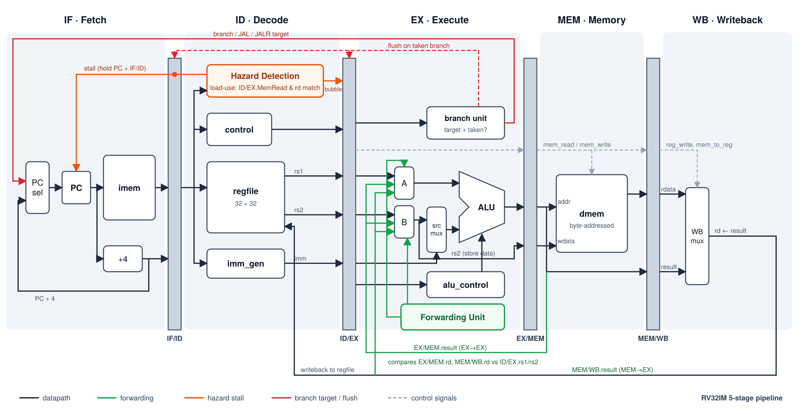

# SystemVerilog-rv32i-Pipelined-Cpu

A RISC-V processor written from scratch in SystemVerilog. It implements the RV32I base integer ISA plus the M (multiply/divide) extension. It is simulated with Verilator and it is written with synthesizable code.
The processor is implemented with a classic 5-stage pipeline with forwarding and hazard detection. 

## Features

- **Full RV32I base ISA** (FENCE/ECALL/EBREAK/CSR not implemented)
  - R-type: `ADD SUB SLL SLT SLTU XOR SRL SRA OR AND`
  - I-type ALU: `ADDI SLTI SLTIU XORI ORI ANDI SLLI SRLI SRAI`
  - Loads: `LB LH LW LBU LHU`
  - Stores: `SB SH SW`
  - Branches: `BEQ BNE BLT BGE BLTU BGEU`
  - Jumps: `JAL JALR`
  - Upper immediates: `LUI AUIPC`
- **M extension**: `MUL MULH MULHSU MULHU DIV DIVU REM REMU`, decoded from `instr[25]` (`funct7 = 0000001`)
- **Byte-addressed data memory** with access width and sign extension controlled by `funct3`
- **Two-level ALU control**: a coarse hint from the main decoder plus a typed ALU operation enum
- **Shared SystemVerilog package** with typed enums for opcodes, `funct3` fields, and ALU operations

## Architecture

### 5-Stage Pipelined Datapath

### Overview of Modules

